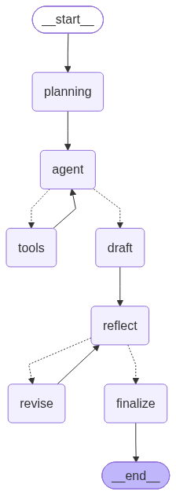

# Python 101 Tutor Copilot

A LangGraph-based agentic RAG system for answering beginner Python
questions with textbook citations, reflection, and observability.

## What It Demonstrates

- Agentic RAG: planning -> retrieval -> draft -> reflection -> revision -> final
- Deterministic retrieval on the answer path
- Citation resolution 
- Reflection loop with a deterministic citation gate
- Langfuse observability with computed scores
- Multi-turn memory via LangGraph checkpointer

## Architecture

## Setup

### Prerequisites
- Python 3.10+
- Ollama (local LLM and embeddings)
- Qdrant (local via Docker, or Qdrant Cloud free tier)
- Langfuse Cloud free tier

### Steps
1. Install dependencies
2. Install Ollama and pull the models
3. Start Qdrant
4. Configure environment
5. Ingest the textbook: python scripts/run_ingestion.py
6. Run the interactive tutor: python src/main.py
7. Or run the demo: python scripts/run_demo.py
